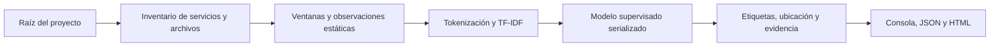

# Informe técnico de VulnMiner

**Laboratorio 1 · Desarrollo de Software Seguro · ESPE**

## Problema y alcance

Los repositorios de microservicios combinan distintos lenguajes, manifiestos y configuraciones. VulnMiner aprende a clasificar patrones locales de riesgo y devuelve al revisor la ubicación y las observaciones que motivaron cada hallazgo. También registra qué categorías puede evaluar. Analiza Java, Python, JavaScript y TypeScript junto con configuraciones, dependencias y definiciones de API.

El catálogo incorpora 20 categorías. Las evaluadas son A01, A02, A04, A05, A07 y A10 de OWASP Top 10:2025 y API1, API2, API4, API8 y API10 de OWASP API Security Top 10:2023. Las nueve restantes se muestran como no evaluadas en el reporte. La correspondencia entre CWE y OWASP se documenta por escenario. [Catálogo web](https://top10.owasp.org/2025/) · [Catálogo API](https://api-security.owasp.org/editions/2023/en/0x11-t10/) · [Correspondencias](../data/README.md)

## Arquitectura

El inventario combina las rutas locales de Compose y los directorios con manifiestos. Asocia archivos con el servicio más cercano y conserva una sección independiente para la configuración de la raíz. El analizador extrae ventanas con números de línea. Las observaciones estáticas sirven para localizar evidencia y construir variables de entrada. Los pesos entrenados y los umbrales aprendidos deciden si la ventana se clasifica, se marca como pendiente o se descarta. El reporte conserva todas las etiquetas aplicables y explica la severidad por impacto potencial. Cada ejecución carga un modelo JSON e inspecciona los archivos localmente. [Código de inventario](../vulnminer/project.py) · [Pipeline](../vulnminer/model.py) · [Integración](../vulnminer/scan.py)

## Metodología SEMMA

| Fase | Procedimiento y evidencia |
| --- | --- |
| Sample | Se diseñaron siete familias de controles a partir de documentación CWE y OWASP. Las 896 muestras brutas se agruparon por origen. Se conservaron 868 después de retirar 28 duplicados. La partición utiliza cinco proyectos sintéticos para entrenamiento, uno para validación y uno para prueba. |
| Explore | El conjunto limpio contiene 434 positivos y 434 controles, con una mediana de dos líneas por fragmento. Hay menos muestras de manejo de excepciones que de verificación de certificados o depuración. Las categorías sin ejemplos se excluyeron del cálculo de F1 macro. |
| Modify | El pipeline elimina comentarios para extraer observaciones, tokeniza y representa unigramas y bigramas mediante TF-IDF logarítmico. Las observaciones estáticas reciben un peso adicional antes de la normalización L2. Solo el conjunto de entrenamiento ajusta el vocabulario y el IDF. La matriz dispersa es reproducible a partir de los datos y scripts. |
| Model | Un clasificador binario estima riesgo y se entrena un clasificador independiente para cada etiqueta. Se comparó regresión logística balanceada con Naive Bayes multinomial. Se ensayó regularización logística de 0,008 y 0,025 y suavizado de Bayes de 0,06 y 0,30. Los umbrales se fijaron por F1 sobre validación. |
| Assess | Se midieron precisión, recall, F1 binario, F1 macro, coincidencia exacta, métricas por etiqueta y matrices de confusión en las 124 muestras de prueba. También se evaluó la CLI sobre dos proyectos separados del corpus. |

[Notebooks SEMMA](../notebooks/) · [Estadísticas descriptivas](../results/explore.json) · [Matriz de características](../results/matrix.jsonl)

## Comparación experimental

| Modelo | Parámetro | F1 macro validación | F1 macro prueba | Precisión binaria | Recall binario |
| --- | ---: | ---: | ---: | ---: | ---: |
| Regresión logística | 0,008 | 1,000 | 1,000 | 1,000 | 1,000 |
| Naive Bayes multinomial | 0,06 | 1,000 | 1,000 | 1,000 | 1,000 |

La comparación dio un empate en F1 macro, F1 binario y coincidencia exacta de validación. Se priorizó regresión logística porque ajusta cada decisión con observaciones correlacionadas sin asumir independencia condicional. Se aplicó el orden declarado de hiperparámetros para el empate dentro del algoritmo. En la prueba controlada, el modelo seleccionado obtuvo 62 verdaderos positivos y 62 verdaderos negativos con cero errores binarios. Los resultados de prueba se calcularon después de seleccionar el modelo. [Métricas, matrices y errores](../results/evaluation.json) · [F1 por categoría](../results/figures/test_categories.svg)

La separación por proyecto y huella evita reutilizar los mismos fragmentos entre entrenamiento y prueba. El diseño compartido de los grupos sintéticos facilita reconocer los patrones ensayados. El F1 de la prueba por fragmentos mide ese escenario controlado y debe interpretarse junto con los errores observados al analizar proyectos completos.

## Pruebas funcionales

Una coincidencia exige la etiqueta correcta en el archivo y la línea anotados. Se cuentan las etiquetas por ubicación, así que un hallazgo con dos etiquetas puede producir dos aciertos o dos errores.

| Proyecto | Servicios | Archivos | Hallazgos | TP | FP | FN | Precisión | Recall | F1 |
| --- | ---: | ---: | ---: | ---: | ---: | ---: | ---: | ---: | ---: |
| `demo-microservices` | 4 | 12 | 7 | 11 | 0 | 0 | 1,000 | 1,000 | 1,000 |
| `review-microservices` | 2 | 6 | 2 | 2 | 2 | 1 | 0,500 | 0,667 | 0,571 |

La demostración reproduce la distribución del enunciado con un gateway, un servicio de usuarios, uno de productos y uno de órdenes. Los siete hallazgos correctos cubren seis categorías web y cinco de API, con evidencia en los cuatro lenguajes y en configuración. [Reporte HTML](../results/demo-microservices/analisis.html) · [Reporte JSON](../results/demo-microservices/analisis.json)

En el segundo proyecto, el acceso a un objeto está protegido por `policy.require_access`. Como el analizador no reconoce esa convención, produce un falso positivo con dos etiquetas. La exportación sin paginar usa un nombre de método ajeno al conjunto de localizadores. Esto impide generar una ventana para clasificarla y produce un falso negativo de API4. [Anotaciones](../examples/expectations.json) · [Evaluación por proyecto](../results/project_evaluation.json)

## Conclusiones y límites

El modelo distingue los patrones incluidos en el corpus y la CLI transforma sus predicciones en evidencia localizada. La prueba adicional muestra que el vocabulario del proyecto y los controles fuera de la ventana local afectan tanto a los falsos positivos como a los falsos negativos. El análisis usa observaciones léxicas, sin inferir flujo de datos entre archivos ni resolver valores de producción. El descubrimiento Compose cubre declaraciones usuales con rutas locales directas o bloques `build.context`. La validación de cada hallazgo queda a cargo del revisor.

Para medir generalización con más rigor se requieren proyectos reales anotados de distintos equipos, ampliar la variedad de APIs por lenguaje y medir por separado la localización de ventanas y la calidad de la clasificación. La ejecución sobre el proyecto del docente queda pendiente de que se proporcione ese repositorio.
